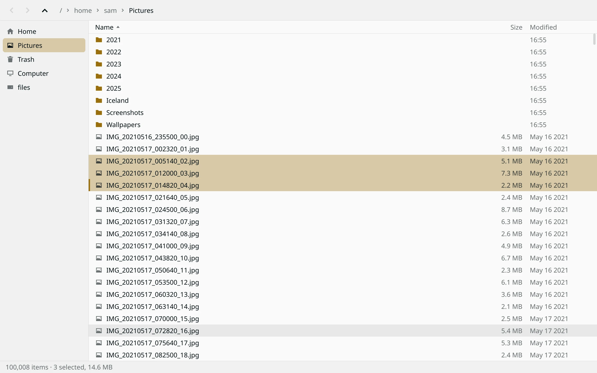

  

<h1 align="center">Gannet</h1>

A very fast file manager for Wayland.

<picture>
  <source media="(prefers-color-scheme: dark)" srcset="docs/assets/browse-dark.webp">
  
</picture>

Gannet is written in Rust and draws on the CPU into shared-memory buffers, with no toolkit
and no GPU. It's been tested on Hyprland and sway.

- **Fast with big folders.** 100,000 files are sorted and on screen in about 28 ms.
- **Quiet when idle.** No wakeups and no CPU use when nothing is happening.
- **Made for the keyboard.** Start typing a name to jump to it. Almost everything has a key.
- **Clear about drags.** A label under the pointer says what a drop will do before you let go.
- **Careful with previews.** Images and videos are decoded in sandboxes, away from your files.
- **At home on your desktop.** It uses your light or dark preference.

Gannet is young, and some things are [missing](#known-gaps).

## Speed

These are for version 0.1.8 on one desktop, in a headless sway with software rendering. The
large folder holds 100,000 empty files. Nautilus normally draws with the GPU, so its numbers
here may be pessimistic.

| With 100,000 files | Gannet | Nautilus 51.1 |
|---|---:|---:|
| First window on screen | 4.1 ms | 148.3 ms |
| Finished loading the folder | 0.02 s | 1.08 s |
| Memory (PSS) | 16.4 MiB | 207.9 MiB |

Gannet also has a set of performance budgets, which `bench/run.py` checks:

| Budget | Limit | Measured |
|---|---:|---:|
| First window, small folder | 25 ms | 3.3 ms |
| Launch to sorted rows, 100,000 files | 150 ms | 28 ms |
| Painting while scrolling, 99th percentile, 1280x800 | 4 ms | 0.8 ms |
| Painting while scrolling, 99th percentile, 3840x2160 | 8.3 ms | 3.9 ms |
| Longest UI stall, slow folder | 16 ms | 3.3 ms |
| Moving 5,000 files to Trash | 1,000 ms | 216 ms |
| Space to the preview window | 25 ms | 6.5 ms |
| Space to a 1600x1200 photo in the preview | 100 ms | 11.1 ms |
| Space to 128 kB of text in the preview | 100 ms | 25.6 ms |
| Space to 128 kB of Markdown in the preview | 150 ms | 25.8 ms |
| Space to the first page of a PDF in the preview | 200 ms | 48.2 ms |
| Idle wakeups | 1 per second | 0 |

To run them yourself, see [bench/README.md](bench/README.md).

## Install

There are no packages yet, so you build Gannet from source. You need a stable Rust toolchain
and `libxkbcommon`.

    git clone https://github.com/aliasproject/gannet
    cd gannet
    cargo build --release -p gannet

Then run it, with a folder or file if you like:

    ./target/release/gannet [FOLDER or FILE]

At run time, Gannet uses these:

| Program | For | Without it |
|---|---|---|
| `fc-match` (fontconfig) | Finding fonts | Gannet can't find a font, so install this |
| `xdg-open` | Opening files in other apps | Opening files fails |
| `xdg-terminal-exec` | Open With for apps that run in a terminal, like Neovim | Open With says it's missing for those apps |
| `bsdtar` (libarchive) | Extracting archives | Extracting says it's missing |
| `xdg-terminal-exec` | Open in terminal, in whichever terminal is set up | Open in terminal isn't offered |
| `libmpv` (part of `mpv` on many systems) and `bubblewrap` | Video and sound previews | Videos show a message saying what's needed |
| `udisks2` | Mounting, unlocking and ejecting drives | Only drives that are already mounted show |
| `shared-mime-info` | Saying what a file is, like "PDF document" | Previews name types like `application/pdf` |
| `poppler` (`pdfinfo`, `pdftoppm`) and `bubblewrap` | PDF previews | PDFs say what they are, or show a thumbnailer's picture |
| Thumbnailers, like `glycin` and `libgsf`, and `bubblewrap` | Previews of HEIC, JPEG XL, SVG, office files and more | Those files say what they are |
| `ffmpeg` (with `ffprobe`) and `bubblewrap` | Videos' thumbnails in the list | Videos keep their icon |

To add it to your app launcher:

    install -Dm755 target/release/gannet ~/.local/bin/gannet
    install -Dm644 packaging/com.aliasproject.Gannet.desktop ~/.local/share/applications/com.aliasproject.Gannet.desktop
    mkdir -p ~/.local/share/icons && cp -r packaging/icons/hicolor ~/.local/share/icons/

`~/.local/bin` needs to be on your `PATH`. This doesn't make Gannet your default for folders.

## Keys

| Action | Keys |
|---|---|
| Move, extend, move without selecting | Arrows, Page Up/Down, Home/End; add Shift; add Ctrl |
| Toggle selection, select all | Ctrl+Space, Ctrl+A |
| Preview | Space |
| Open | Enter |
| Up, back, forward, home | Backspace or Alt+Up, Alt+Left, Alt+Right, Alt+Home |
| Places in the sidebar | Alt+1 to Alt+9 |
| Move to the sidebar and back | F6, then Up/Down, Enter, Escape |
| Jump to a name | Just type it |
| Search here and in the folders inside | Ctrl+F |
| Filter this folder, type a path | `/`, Ctrl+L |
| Show a search's match in its folder | Alt+Enter |
| Hidden files | Ctrl+H |
| Sort by name, size, modified (again to reverse) | Ctrl+1, Ctrl+2, Ctrl+3 |
| Copy, cut, paste | Ctrl+C, Ctrl+X, Ctrl+V |
| Copy path as text | Ctrl+Shift+C |
| Rename (several at once too), new folder | F2, Ctrl+Shift+N |
| Move to Trash, delete for good | Delete, Shift+Delete |
| Undo, redo | Ctrl+Z, Ctrl+Shift+Z |
| Stop the newest operation | Ctrl+. |
| Context menu, of a file or of a pin or drive in the sidebar | Menu key, F10 or Shift+F10 |
| Reload, new window, close | F5 or Ctrl+R, Ctrl+N, Ctrl+Q or Ctrl+W |

## Searching

Ctrl+F searches the folder showing and every folder inside it for names that contain what's
typed, ignoring case. `/` filters only the folder showing. In the box, Ctrl+F turns a search
into a filter and back, keeping what's typed. Matches appear
as they're found, nearest folders first, with where each one is beside it, and each letter
typed starts the search again. Enter opens a match, Alt+Enter shows it in its folder, and
going back from there comes back to the search. Escape ends it.

There's no index: each search reads the folders as they are now, and nothing runs while
you're not searching. Reading 200,000 files takes a few tens of milliseconds once they've been
read before. A search stays on the folder's own disk, so other disks, network shares and
`/proc` mounted inside aren't read, and it doesn't follow symlinks to folders. Hidden folders
are only searched while hidden files show. It stops after 1,000 matches, and says so. Only
the folder searched is watched for changes, so a file changed deeper down by another program
shows as it was until the search runs again (F5, or typing). Changing the sort while searching
sorts the folder that way too.

## Sorting

Each folder keeps the order you last sorted it in, and a folder you haven't sorted takes the
order of the nearest folder above it that you have. So sorting `~/Projects` by date sorts every
project in it too. Sorting a folder the same way as the folder above it makes it follow that
folder again. Downloads, Pictures and Videos start newest first, and stay that way when a
folder above them is sorted, until you sort them yourself. Names sort A to Z at first, dates
newest first and sizes biggest first; sorting by the same column again reverses it. Folders
always come first. The preview window walks a folder in the order the list shows it, and Open
and Save dialogs from other apps read and save the same orders. The orders are kept in
`$XDG_STATE_HOME/gannet/sorts`, which is `~/.local/state/gannet/sorts` by default.

## Dragging

Drag files onto a folder in the list or a place in the sidebar. Dragging one selected item
takes the whole selection. With no keys held it moves on the same disk and copies to another.
Ctrl copies, Shift moves, and Ctrl+Shift makes a symbolic link: the keys held at the drop
decide. The pointer carries the file's row, and a label under it says what a drop will do.
Escape cancels.

A drag carries files from a row's icon or name. From anywhere else on a row, or below the rows,
it draws a box instead, and selects every row the box touches. Ctrl or Shift adds to the
selection, dragging past the top or bottom scrolls, and Escape puts the selection back.

A drag to another Gannet window follows the same rules, and the window it lands in does the work.
Many compositors keep the keyboard from that window during a drag. It then goes by the keys held
as the drag left the first window, so press them before leaving. The label says which it will be.

Drags also go to and from other apps. Dragged out, a plain drag offers a copy and Shift offers
a move, and the other app does the work. Gannet never deletes anything because of what it
reports back. Dropped in, Gannet does the work and copies, unless the other app only offers a
move.

A picture dragged from a web page is saved in the folder it lands on, named from its address,
when the browser hands over the picture itself, as Firefox and Zen do. A browser that offers
only a link gets a message saying so. While a drag that can't go to the Trash is over the
window, such as a picture from a browser, the Trash shows dimmed.

## Show in folder

Other programs can show a file in Gannet, such as a browser's "Show in folder" for a
download. Gannet opens the file's folder with it selected. This goes through the
`org.freedesktop.FileManager1` D-Bus service, which Nautilus and other file managers also
provide.

Packages install `packaging/com.aliasproject.Gannet.FileManager1.service` into
`/usr/share/dbus-1/services`, named for Gannet so it can't clash with Nautilus's file. With
more than one file manager installed, which one D-Bus starts depends on the bus, so to be
sure it's Gannet:

    gannet --claim-show-in-folder      # Gannet answers "Show in folder" for you
    gannet --release-show-in-folder    # back to whatever answered before

Claiming writes `~/.local/share/dbus-1/services/org.freedesktop.FileManager1.service`, which
D-Bus reads before any installed file, and asks D-Bus to reread its files. It records where
`gannet` is, so claim again after moving it. Releasing removes that file again; a file there
that Gannet didn't write is never touched. A file manager already running and answering keeps
doing so until it exits.

`gannet --file-manager-service` is what D-Bus starts. It has no window: it opens one for each
request, and exits after ten minutes with none. Windows need `WAYLAND_DISPLAY` in the
environment D-Bus gives services; check with `systemctl --user show-environment`, and if it's
missing, have the compositor run `dbus-update-activation-environment --systemd WAYLAND_DISPLAY`
at startup. The service's errors go to the journal.

## Open and Save dialogs

Gannet can be the Open and Save dialog other programs show, such as a browser's upload
button or an editor's Save As. It's the usual file list, with the program's question along
the bottom: the name to save as, a list of file types if the program gave any, and the
buttons that finish it. Enter on a folder goes into it, and Enter or a double click on a file
picks it. Escape or closing the window cancels. Saving over a file that's there asks first,
and typing a folder's name goes into that folder. Gannet only hands back the paths: the
program does the opening and saving.

This goes through xdg-desktop-portal's file chooser, which GTK apps, Chromium-based browsers
and Electron apps use. Firefox, and browsers built on it like Zen, use the portal only in
Flatpak unless `widget.use-xdg-desktop-portal.file-picker` is set to `1` in `about:config`.
GTK apps outside Flatpak use it with `GTK_USE_PORTAL=1` (GTK 3) or `GDK_DEBUG=portals` (GTK 4).

Packages install `packaging/gannet.portal` into `/usr/share/xdg-desktop-portal/portals` and
`packaging/org.freedesktop.impl.portal.desktop.gannet.service` into
`/usr/share/dbus-1/services`. That makes Gannet available, but not the dialog programs get,
as installing a file manager shouldn't change that by itself. To choose it, put this in
`~/.config/xdg-desktop-portal/portals.conf` for yourself, or in
`/etc/xdg/xdg-desktop-portal/portals.conf` for everyone:

    [preferred]
    org.freedesktop.impl.portal.FileChooser=gannet;gtk
    org.freedesktop.impl.portal.AppChooser=gannet;gtk

then restart the portal with `systemctl --user restart xdg-desktop-portal`. The second line
is for Open With (below) and can be left out. Other portals
stay as your desktop's own configuration has them, as xdg-desktop-portal reads each file in
turn for what earlier ones leave out. `gtk` after `gannet` is what's used if Gannet isn't
installed. Older versions of xdg-desktop-portal read only the first file they find, so with
those, copy your desktop's lines from `/usr/share/xdg-desktop-portal/*-portals.conf` into it.

`gannet --file-chooser-service` is what D-Bus starts. It has no window: it opens one for
each request, `gannet --choose ...` or `gannet --open-with ...`, and exits after ten minutes
with none open. Like "Show in folder", it needs `WAYLAND_DISPLAY` in the environment D-Bus
gives services. A dialog sits over the program's window as its child where the compositor
supports xdg-foreign, and its app ID is `com.aliasproject.Gannet.Chooser` for window rules.

## Open With

Right-click one or more files and choose Open with… to pick an app other than the default.
The apps for the file's type come first, with the default marked, then every other app, by
name. Typing searches them, the arrows move, and Enter or a double click opens. Escape clears
the search, then cancels. "Always use for … files" (Space, before typing) also makes the app
the default for that type, in `~/.config/mimeapps.list`, where `xdg-open` and other file
managers look; Undo doesn't reverse that, but choosing another app the same way does. It's
there for an archive too, which opening extracts in Gannet, so another app can open it instead.

Apps come from the desktop entries in `~/.local/share/applications` and
`/usr/share/applications` (`XDG_DATA_DIRS`), and the defaults from the `mimeapps.list` files,
as the freedesktop specs describe. An entry whose program isn't installed is left out. An app
that runs in a terminal, like Neovim, opens in yours through `xdg-terminal-exec`.

The same window answers other programs' "Open with…" requests through xdg-desktop-portal's
app chooser, with the `AppChooser` line above. Only sandboxed programs, such as Flatpaks, ask
it, when they open a file or link with no default app. There it lists the apps the program
offers, and the portal opens the one picked.

## Set as background

Right-click a picture and choose Set as background. Gannet asks xdg-desktop-portal's
Wallpaper portal, so the desktop sets it its own way, and the first time the portal may ask
whether Gannet is allowed to. The item only shows where the portal can do it: GNOME's and KDE's
portals can, and so can aliasOS's once it has its Wallpaper portal backend. Elsewhere, such as
on sway with only the GTK and wlr portals, it stays hidden rather than doing nothing. It shows
up without restarting Gannet once the portal starts with one that can.

## Open in terminal

Right-click a folder, or the empty space in a folder, and choose Open in terminal. Gannet asks
`xdg-terminal-exec` for it, so it opens whichever terminal `~/.config/xdg-terminals.list` names,
in that folder. Where a systemd user manager runs, the terminal gets a scope of its own, as apps
started from a launcher do, so it stays open when Gannet closes. It isn't offered for files, in the Trash or Recent, in
Open and Save dialogs, or where `xdg-terminal-exec` isn't installed. If the terminal can't
start, the window says so.

## Archives

Opening a zip, tar (`.tar.gz`, `.tar.zst` and the others), 7z, rar or cpio archive extracts it
into a new folder beside it, rather than handing it to another app, and selects that folder.
The folder is named after the archive, or `photos (2)` and so on if that name is taken. When
everything in the archive is inside one folder, that folder comes out as itself, not wrapped in
another one. Extract is also in the right-click menu. It runs as a job you can stop, and Undo
moves the folder to the Trash. A damaged archive, one with a password, or one with items that
would land outside its folder or links that point outside it leaves nothing behind and says why. In Open and Save dialogs,
opening an archive picks it, as any other file. To open one in another app, use Open with….

## Pinned folders

Drag a folder between places in the sidebar to pin it there, under Pinned: below Trash, or
just above or below a pin. A bar shows where it will land. Dropping onto a place still moves
the folder into it; pinning never moves or changes the folder. Files can't be pinned. Drag a
pin up or down to put the pins in another order, and Escape puts it back. Right-click a pin
to unpin it, which leaves the folder alone, or press F6, move to it and press the Menu key.
Alt+1 to Alt+9 follow the sidebar, pins included.

When the places don't fit, the sidebar scrolls with the wheel or its scroll bar. A drag held
near its top or bottom edge scrolls it too, and Alt+1 to Alt+9 scroll the place they open
into view.

Pins are GTK's bookmarks, kept in `$XDG_CONFIG_HOME/gtk-3.0/bookmarks`, so they're shared
with Nautilus and GTK's Open and Save dialogs, and every open Gannet window follows changes to
that file. Gannet only shows local folders, and keeps every other line, like an `sftp://`
bookmark, as it was. A standard folder like Documents that's also bookmarked shows once, in
Places. A pinned folder that's gone stays in the sidebar until it's unpinned.

## Recent

Recent in the sidebar lists the files you've used lately, newest first, with the folder each
is in and when you last used it. It's the list GTK apps, browsers and Nautilus keep in
`~/.local/share/recently-used.xbel`, so a download or a file saved in another app shows up
there. Gannet only reads it, and only when you open Recent. Files that are gone are left out.
Right-click a file and choose Show in folder to go to it. Recent only lists files: to rename,
move or trash one, show it in its folder first.

## Trash

Trash in the sidebar lists everything you've trashed on every disk, with where each item
came from and when it was deleted. Right-click to restore items or delete them for good, or
use Empty Trash in the toolbar. Restoring never overwrites anything: if something new has
taken an item's place, the item stays in the Trash and Gannet says why. Network shares'
and automounted disks' Trash folders aren't shown. A disk that stops answering is left out
after a few seconds, and the status bar says so.

When a paste or a drop meets a name that's taken, Replace moves the item already there to
the Trash rather than overwriting it. If it can't go to the Trash, both are left as they
were.

## Renaming several files

Select several items and press F2, or choose Rename from the right-click menu, to rename them
all at once. Type text in Find and what to put in its place in Replace with: every place it
appears in each name changes. Leave Find empty and Replace with becomes the whole new name, and
files keep their extensions. `{n}` in Replace with counts 1, 2, 3 in the order the list shows,
with zeros in front so they sort in order (01 to 12 for twelve items).

Each old name shows beside its new one before anything changes. Rename stays off while two
items would get the same name, or one would take the name of something else in the folder, and
the line under the names says which. Items can take each other's names, so a↔b swaps work.
It's all or nothing: if one rename fails partway, the ones already done are put back. One undo
puts every name back.

## Undo and redo

Ctrl+Z undoes a copy, move, rename, new folder, link, restore, extract or move to the Trash, and
Ctrl+Shift+Z redoes it. Undo never deletes anything: copies go to the Trash, and so does a
new folder that something has been put in. An empty one is just removed. Undoing a Replace
brings back the item it replaced. Gannet checks that each item is still the one the change
left there, so if something else has taken its name since, that item is left alone and
Gannet says so. A merge of two folders, and deleting for good, can't be undone.

## Command line

Scripts and agents can handle files the way the window does, with no display and without
D-Bus:

    gannet list [--json] [--hidden] [--sort name|size|modified] [--reverse] [FOLDER]
    gannet info [--json] PATH...
    gannet trash [--json] PATH...
    gannet restore [--json] [PATH...]

- `list` lists a folder, or the current one, in the window's order: folders first, then the
  order last chosen for that folder in the window (see [Sorting](#sorting)), or names A to Z.
  `--sort` picks an order instead, the way a first press in the window would: names A to Z,
  sizes biggest first, dates newest first. `--reverse` turns it round. Listing never changes
  the saved orders. Names starting with a dot are left out unless `--hidden` is given.
- `info` says what each path is: its kind, size, times and permissions, where a link leads, and
  for an item in the Trash, where it came from and when it was deleted. Links aren't followed.
- `trash` moves each path to the Trash, on its own disk when it's not on the home disk, as the
  window does.
- `restore` with no paths lists the Trash on every disk. With paths, it puts those items back.
  A path is an item's path in the Trash or the path it came from. If several items came from
  the same path, the one deleted last comes back. Restoring never overwrites anything: an item
  whose place is taken stays in the Trash and that's reported as an error.

A path can also be a `file://` URI. Use `--` before paths that start with `-`. These four
words are commands, so to open a folder called `list` in the window, run `gannet ./list`.

Without `--json`, the output is for people and may change. The exit code is 0 when everything
asked for was done and 1 otherwise, including bad arguments. Each error is also written to
stderr as `gannet COMMAND: PATH: message`. That's for people: a path can hold a newline, so
read errors from the JSON. `trash` refuses an empty path and one ending in `.` or `..`, as
`rm` does, and every command refuses an empty path.

### JSON output

With `--json`, each command prints one JSON object on one line. It's stable within a
`version`. New fields can be added in the same version, so ignore ones you don't know. A
field is only renamed, removed or changed in meaning with a new version number. Every object
has:

| Field | |
|---|---|
| `version` | `1` |
| `command` | `"list"`, `"info"`, `"trash"` or `"restore"` |
| `errors` | `[{"path", "message"}]`, empty on success; `path` is `null` for an error with no path |

Bad arguments give only these three fields, with the reason and the usage in `errors`.
Otherwise there are more, by command:

| Command | Fields |
|---|---|
| `list` | `folder`, `folder_uri`, `sort` (`{"key": "name"\|"size"\|"modified", "descending"}`), `hidden`, `items` |
| `info` | `items`, one for each path that exists, in order |
| `trash` | `trashed`: `[{"path", "uri", "trash_path", "trash_uri"}]`, where each item was and where it is now |
| `restore` with no paths | `items`, everything in the Trash, in the window's order for the Trash |
| `restore` with paths | `restored`: `[{"path", "uri", "trash_path", "trash_uri"}]`, where each item is now and where it was in the Trash |

Each of `items` has every one of these fields, `null` where it doesn't apply:

| Field | |
|---|---|
| `name` | The name. In `restore`'s list, the name it had before it was deleted |
| `path`, `uri` | Where it is. `path` is text; a name that isn't UTF-8 has `U+FFFD` in place of the bytes that aren't, so use `uri` (exact, percent-encoded) to pass it back |
| `kind` | `"file"`, `"folder"`, `"symlink"` or `"other"` (devices, pipes and sockets) |
| `size` | Bytes, for files only |
| `modified`, `accessed`, `changed`, `created` | Seconds since 1970-01-01 UTC. `created` is `null` where the filesystem doesn't record it |
| `mode` | Permissions in octal, like `"0644"` |
| `hidden` | Whether the name starts with a dot |
| `target`, `target_kind` | For a symlink: where it points, as written, and what's there: `"file"`, `"folder"`, `"other"` or `"missing"` |
| `trash` | For an item in the Trash: `{"original", "original_uri", "deleted"}`, where it came from and when it was deleted (seconds since 1970). `original` is `null` if its record in the Trash can't be read, and then it can't be restored |

## Drives

USB sticks, SD cards and other drives you plug in show in the sidebar, whether they're mounted
or not. Click one to mount and open it. A drive that can come out has an eject button, which
unmounts everything on it and powers it off so it's safe to pull out. Right-click a drive for
Unmount and Eject, or press F6, move to it and press the Menu key. An encrypted drive shows a
lock, and asks for its passphrase when you open it. Unmounting or ejecting it locks it again.

Unmounting or ejecting a drive closes the preview window, and if the window is showing the
drive, takes it home first. If another program has files on the drive open, it stays put and
Gannet says why. If the window is showing a drive that goes away, it goes home. The computer's
own disks stay out of the way, as udisks2 marks them.

This goes through udisks2, which most Linux desktops run. Polkit decides what's allowed, and
asks for a password if the system says to. Before acting on a drive, Gannet checks it's still
the one you picked, as another stick put in can take the same place.

## Thumbnails

Pictures and videos in the list show a small picture of themselves in place of their icon,
cut to a square from the middle. The icon shows until the picture is ready, and stays for a
file that can't be shown. Folders, and anything in the Trash, keep their icons.

Thumbnails are kept in the freedesktop cache (`~/.cache/thumbnails`, or under
`$XDG_CACHE_HOME`) that other apps share, so one another app made is used, and the ones Gannet
makes, at the 128-pixel "normal" size, are there for other apps. A file that changes gets a new
one. A file that can't be made into one is noted in `thumbnails/fail/gannet`, so it isn't tried
again until it changes or Gannet is updated.

Only the rows on screen get thumbnails, and scrolling past a row drops it from the queue, or
stops it if it's being made, so scrolling never waits. They're made in the background, two at
a time, at the lowest CPU priority and a low disk priority. Pictures are read by the preview's sandboxed
decoder, and ones it can't read, like HEIC and SVG, by the system's thumbnailers. Videos get a
frame from a tenth of the way in, from `ffmpeg`. Both run as the preview's do (see
[Sandboxing](#sandboxing)).

## Preview

Space opens the file under the cursor in a preview window, and Space or Escape closes it, in
either window. Arrows, or the mouse's back and forward buttons, go to the next or previous
file, and the list's cursor follows; moving the cursor in the list changes the preview too.
Enter opens the file in its app. Plus and minus zoom, 0 fits, and Shift+arrows or dragging
moves a zoomed image around.

The preview runs as a program of its own, `gannet --preview FILE`, so a file that crashes it
closes only the preview, and the list says so. Its app ID is `com.aliasproject.Gannet.Preview`,
for window rules: on aliasOS it floats over the list. Elsewhere, add a rule to float it if you
like; without one, it opens beside the list like any other window.

Images are PNG, JPEG, WebP, GIF, BMP, TIFF and ICO. GIFs, animated WebPs and animated PNGs
move. If another program has already made a thumbnail, it shows until the full image is ready.

Videos and sound play using libmpv. P or Enter pauses, Shift+Left and Shift+Right seek,
Shift+Up and Shift+Down set the volume, and M mutes. Clicking the picture pauses, and the
footer has the same controls for the mouse. Sound shows what the file is while it plays.

Text shows the first 128 KiB of the file, cut at the end of a line, and Markdown is shown
formatted. A file with a zero byte in its first 8,000 bytes isn't text. Page Up, Page Down,
Home, End, Shift+Up, Shift+Down and the mouse wheel scroll it.

PDFs show their pages one under another, each drawn by poppler's `pdftoppm` as it scrolls into
view, and scroll like text. A locked or damaged PDF says so.

HEIC and JPEG XL photos, SVG drawings, office documents and anything else the system has a
thumbnailer for (the `.thumbnailer` files in `~/.local/share/thumbnailers` and the
`thumbnailers` folder of each `XDG_DATA_DIRS` entry, like `/usr/share/thumbnailers`) show the biggest
picture the thumbnailer makes for the window's size.

Folders show how many items they hold and their total size, counted in the background. Like
`du`, the count doesn't follow symlinks or go onto other disks, and a file with several hard
links counts once.

Anything else shows what it is, from the system's file type database (shared-mime-info): its
icon, or a thumbnail another program made, its type ("PDF document"), size and date, and an
Open button. The type comes from the file's name, or from its first few kilobytes when the
name doesn't say.

### Sandboxing

Files you preview may have come from anywhere, so the code that reads them runs apart from
the app.

**Images, text and Markdown** are read in a separate process, one per file, with limits on its
memory and CPU time.
A seccomp sandbox stops that process opening or looking up files, making network connections,
starting programs or making memory executable, and it won't decode if the sandbox can't be set
up. It can still read the one file it was given and write its one output. Stopping a preview
kills that process.

**PDFs and thumbnailers** run in the same bubblewrap jail as videos, below, with fonts to draw
text and limits on memory, CPU time and output. The file is handed in already open, so it can't
be swapped on the way. What they make is a PNG, which the image decoder above reads in its own
sandbox. They don't get the player's seccomp filter, as some thumbnailers start sandboxes of
their own, which it would stop.

**Videos and sound** play in a bubblewrap jail with no home folder, no network, no `/proc` and read-only
system files, under a seccomp filter that stops it starting programs, creating processes or
asking for executable memory. The player can read the one video and system files, run the code
already loaded, draw its frames, write to its own temporary folder, and use the sound socket.
A sound server normally lets its clients record too, so with sound on that can include the
microphone.

## Theme

On aliasOS, Gannet uses the theme's own colors, from
`~/.local/state/aliasos/current/theme/colors.toml`, and changes with the theme while it's open.
Elsewhere, it uses the light or dark preference from your GTK settings or `gsettings`, with a
built-in palette, and asks `gsettings` again whenever its window regains focus. With no
preference set, it's light.

Text is in your monospace font at 13 px, the one `aliasos-font-set` picks on aliasOS, so
Gannet matches the terminal and the bar. Pick another and Gannet uses it from its next start.
The chevrons, drive and lock icons are [Lucide](https://lucide.dev)'s (ISC, see
`LICENSES/lucide.txt`); the rest are Gannet's own.

## Screen readers

Gannet works with screen readers such as Orca, over AT-SPI. It joins the accessibility bus
only while a screen reader is on, and does no work for one otherwise.

The file list reads as a table named for the folder: each row's name, then whether it's a
folder, its size and when it changed, and in Recent, the Trash and search results, where it
is. The sidebar with its headings, the path bar, the column headings (which sort), the path,
filter, search and rename fields, menus, questions such as "Delete for good?", the rename
dialog, notices and the progress of copies are read too, and changes are announced as they
happen. The drive-unlock prompt reads its passphrase as dots and never gives it out. The
preview, the Open and Save dialogs and Open With are windows of their own and read the same
way.

Typing echo and Orca's own key commands depend on the desktop passing keys to Orca, which not
every Wayland compositor does. F6 moves the keyboard to the sidebar and back, and the
sidebar's place with the keyboard is read as it moves. A pin or a drive has a second action,
Show menu, which opens its menu as the Menu key does.

## Known gaps

- No tabs yet.
- No input methods, compose or right-to-left text yet.
- Copies keep mode, times and extended attributes, but not ownership or hard links.
- Wayland only, so there's no X11 support.

## Development

The code is in two crates. `crates/core` holds listing, sorting, file operations, Trash,
theme handling and D-Bus. `crates/app` holds the Wayland client, drawing, input and previews.

Tests can destroy data, so they're fenced in:

    scripts/test.sh               # unit tests, in bubblewrap with the real home hidden
    python3 -B tests/e2e.py       # the real app in a headless compositor, on scratch folders
    python3 -B bench/run.py       # budgets; see bench/README.md for what to build first

Plain `cargo test` refuses to run anything that touches files, so run the unit tests with
`scripts/test.sh`, which also builds the stand-in udisks2 the drive tests talk to. The D-Bus
tests start a private `dbus-daemon` of their own and call it with `busctl`, so both need to be
installed.

For the end-to-end checks:

    bench/harness/fetch-tools.sh
    CARGO_TARGET_DIR=target/bench cargo build --release -p gannet --features bench
    CARGO_TARGET_DIR=target/bench cargo build --release -p gannet-core --example udisks-standin
    (cd bench/harness/vptr && CARGO_TARGET_DIR=../../../target/vptr cargo build --release)

The drive checks run a stand-in for udisks2 (`crates/core/examples/udisks-standin.rs`) on a
private bus, so no check ever reaches the real one or a real drive.

The screen-reader checks run the real `at-spi2-registryd` on private buses with a scripted
libatspi client (`tests/a11y_client.py`). To hear what Orca makes of Gannet, with the same
builds and `orca` installed:

    python3 -B tests/orca_tour.py

It walks through the window, the preview, the Save dialog and Open With with Orca listening,
and writes what Orca said after each step to `.bench/orca-tour.txt`, with Orca's debug log
beside it. Orca runs in bubblewrap on the private buses, with no sound devices, no
speech-dispatcher and its settings in memory, so nothing is spoken aloud and your own Orca
settings aren't touched. It fails if the passphrase typed at the unlock prompt appears
anywhere in Orca's log.

### Keeping tests off the desktop's buses

A test must never reach your session's D-Bus or its accessibility bus. Starting
`at-spi-bus-launcher` anywhere with your real `XDG_RUNTIME_DIR` is enough to break it: the
launcher unlinks `$XDG_RUNTIME_DIR/at-spi/bus_0` and binds its own socket there. When it
exits, the desktop's accessibility bus keeps running on a socket nobody can find, and Orca
fails to start with "Couldn't connect to accessibility bus". `dbus-run-session` doesn't
prevent this. It gives you a private session bus, but that bus starts the system's
`org.a11y.Bus` service, and the launcher it starts still uses the real runtime folder. A GTK
or Qt app on a private bus is enough to trigger it.

So `tests/e2e.py`, `tests/orca_tour.py`, `bench/run.py` and `bench/bakeoff/run.py` run themselves again inside
bubblewrap (`bench/harness/isolate.py`), with:

- an empty tmpfs over `/run/user/$UID`, which is also `XDG_RUNTIME_DIR`;
- an empty `/tmp/.X11-unix`, no `DISPLAY` or `WAYLAND_DISPLAY`, and no network, so nothing
  can reach Xwayland;
- `DBUS_SESSION_BUS_ADDRESS` pointing nowhere and `AT_SPI_BUS_ADDRESS` unset.

Inside the sandbox, each one checks that the real sockets can't be seen, and refuses to run
if they can. Outside it, the inode and times of `$XDG_RUNTIME_DIR/bus` and everything in
`$XDG_RUNTIME_DIR/at-spi` are recorded before the run and checked after it. The run fails
loudly, with exit code 3 if nothing else failed, when one was replaced, removed or added.
`scripts/test.sh` does the same check around `cargo test`. Its test binaries already run
with `/run` covered, but doc-tests and build scripts don't, so for those the check is the
only guard. To check the guard itself:

    python3 -B bench/harness/isolate.py --self-test

Run a one-off probe or prototype the same way, inside the guard, never on its own or only in
`dbus-run-session`:

    python3 -I -c 'import sys; sys.path.insert(0, "bench/harness"); import isolate; sys.exit(isolate.run_guarded(sys.argv[1:]))' ./probe.sh

If a run did break the bus, `ss -xlpe` shows `dbus-broker` listening on `at-spi/bus_0` with
an `ino:` that differs from the file's inode in `stat`. Restart the launcher with
`pkill -f at-spi-bus-launcher`, and D-Bus starts it again the next time something asks.

## License

[MIT](LICENSE)
