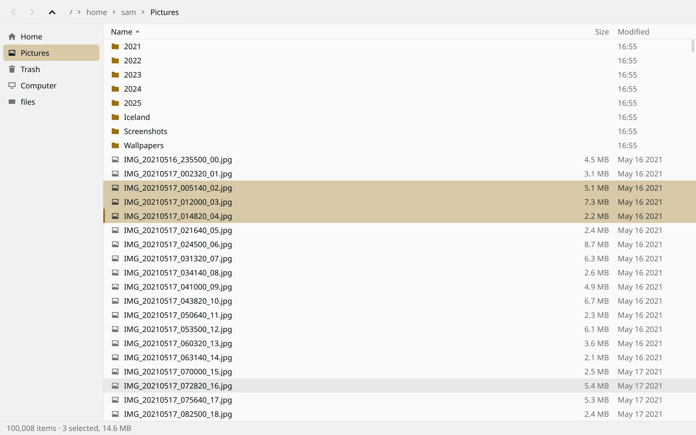

  

<h1 align="center">Gannet</h1>

A very fast file manager for Wayland.

<picture>
  <source media="(prefers-color-scheme: dark)" srcset="docs/assets/browse-dark.webp">
  
</picture>

Gannet is written in Rust and draws on the CPU into shared-memory buffers, with no toolkit
and no GPU. It's been tested on Hyprland and sway.

- **Fast with big folders.** 100,000 files are sorted and on screen in about 28 ms.
- **Quiet when idle.** No wakeups and no CPU use when nothing is happening.
- **Made for the keyboard.** Start typing a name to jump to it. Almost everything has a key.
- **Clear about drags.** A label under the pointer says what a drop will do before you let go.
- **Careful with previews.** Images and videos are decoded in sandboxes, away from your files.
- **At home on your desktop.** It uses your light or dark preference.

Gannet is young, and some things are [missing](#known-gaps).

## Speed

These are for version 0.1.8 on one desktop, in a headless sway with software rendering. The
large folder holds 100,000 empty files. Nautilus normally draws with the GPU, so its numbers
here may be pessimistic.

| With 100,000 files | Gannet | Nautilus 51.1 |
|---|---:|---:|
| First window on screen | 4.1 ms | 148.3 ms |
| Finished loading the folder | 0.02 s | 1.08 s |
| Memory (PSS) | 16.4 MiB | 207.9 MiB |

Gannet also has a set of performance budgets, which `bench/run.py` checks:

| Budget | Limit | Measured |
|---|---:|---:|
| First window, small folder | 25 ms | 3.3 ms |
| Launch to sorted rows, 100,000 files | 150 ms | 28 ms |
| Painting while scrolling, 99th percentile, 1280x800 | 4 ms | 0.8 ms |
| Painting while scrolling, 99th percentile, 3840x2160 | 8.3 ms | 3.9 ms |
| Longest UI stall, slow folder | 16 ms | 3.3 ms |
| Moving 5,000 files to Trash | 1,000 ms | 216 ms |
| Space to the preview window | 25 ms | 6.5 ms |
| Space to a 1600x1200 photo in the preview | 100 ms | 11.1 ms |
| Space to 128 kB of text in the preview | 100 ms | 25.6 ms |
| Space to 128 kB of Markdown in the preview | 150 ms | 25.8 ms |
| Space to the first page of a PDF in the preview | 200 ms | 48.2 ms |
| Idle wakeups | 1 per second | 0 |

To run them yourself, see [bench/README.md](bench/README.md).

## Install

There are no packages yet, so you build Gannet from source. You need a stable Rust toolchain
and `libxkbcommon`.

    git clone https://github.com/aliasproject/gannet
    cd gannet
    cargo build --release -p gannet

Then run it, with a folder or file if you like:

    ./target/release/gannet [FOLDER or FILE]

At run time, Gannet uses these:

| Program | For | Without it |
|---|---|---|
| `fc-match` (fontconfig) | Finding fonts | Gannet can't find a font, so install this |
| `xdg-open` | Opening files in other apps | Opening files fails |
| `libmpv` (part of `mpv` on many systems) and `bubblewrap` | Video and sound previews | Videos show a message saying what's needed |
| `shared-mime-info` | Saying what a file is, like "PDF document" | Previews name types like `application/pdf` |
| `poppler` (`pdfinfo`, `pdftoppm`) and `bubblewrap` | PDF previews | PDFs say what they are, or show a thumbnailer's picture |
| Thumbnailers, like `glycin` and `libgsf`, and `bubblewrap` | Previews of HEIC, JPEG XL, SVG, office files and more | Those files say what they are |

To add it to your app launcher:

    install -Dm755 target/release/gannet ~/.local/bin/gannet
    install -Dm644 packaging/com.aliasproject.Gannet.desktop ~/.local/share/applications/com.aliasproject.Gannet.desktop
    mkdir -p ~/.local/share/icons && cp -r packaging/icons/hicolor ~/.local/share/icons/

`~/.local/bin` needs to be on your `PATH`. This doesn't make Gannet your default for folders.

## Keys

| Action | Keys |
|---|---|
| Move, extend, move without selecting | Arrows, Page Up/Down, Home/End; add Shift; add Ctrl |
| Toggle selection, select all | Ctrl+Space, Ctrl+A |
| Preview | Space |
| Open | Enter |
| Up, back, forward, home | Backspace or Alt+Up, Alt+Left, Alt+Right, Alt+Home |
| Places in the sidebar | Alt+1 to Alt+9 |
| Jump to a name | Just type it |
| Filter, type a path | Ctrl+F or `/`, Ctrl+L |
| Hidden files | Ctrl+H |
| Sort by name, size, modified (again to reverse) | Ctrl+1, Ctrl+2, Ctrl+3 |
| Copy, cut, paste | Ctrl+C, Ctrl+X, Ctrl+V |
| Copy path as text | Ctrl+Shift+C |
| Rename, new folder | F2, Ctrl+Shift+N |
| Move to Trash, delete for good | Delete, Shift+Delete |
| Undo rename, move or Trash | Ctrl+Z |
| Stop the newest operation | Ctrl+. |
| Context menu | Menu key or F10 |
| Reload, new window, close | F5 or Ctrl+R, Ctrl+N, Ctrl+Q or Ctrl+W |

## Dragging

Drag files onto a folder in the list or a place in the sidebar. Dragging one selected item
takes the whole selection. With no keys held it moves on the same disk and copies to another.
Ctrl copies, Shift moves, and Ctrl+Shift makes a symbolic link: the keys held at the drop
decide. The pointer carries the file's row, and a label under it says what a drop will do.
Escape cancels.

A drag carries files from a row's icon or name. From anywhere else on a row, or below the rows,
it draws a box instead, and selects every row the box touches. Ctrl or Shift adds to the
selection, dragging past the top or bottom scrolls, and Escape puts the selection back.

A drag to another Gannet window follows the same rules, and the window it lands in does the work.
Many compositors keep the keyboard from that window during a drag. It then goes by the keys held
as the drag left the first window, so press them before leaving. The label says which it will be.

Drags also go to and from other apps. Dragged out, a plain drag offers a copy and Shift offers
a move, and the other app does the work. Gannet never deletes anything because of what it
reports back. Dropped in, Gannet does the work and copies, unless the other app only offers a
move.

## Show in folder

Other programs can show a file in Gannet, such as a browser's "Show in folder" for a
download. Gannet opens the file's folder with it selected. This goes through the
`org.freedesktop.FileManager1` D-Bus service, which Nautilus and other file managers also
provide.

Packages install `packaging/com.aliasproject.Gannet.FileManager1.service` into
`/usr/share/dbus-1/services`, named for Gannet so it can't clash with Nautilus's file. With
more than one file manager installed, which one D-Bus starts depends on the bus, so to be
sure it's Gannet:

    gannet --claim-show-in-folder      # Gannet answers "Show in folder" for you
    gannet --release-show-in-folder    # back to whatever answered before

Claiming writes `~/.local/share/dbus-1/services/org.freedesktop.FileManager1.service`, which
D-Bus reads before any installed file, and asks D-Bus to reread its files. It records where
`gannet` is, so claim again after moving it. Releasing removes that file again; a file there
that Gannet didn't write is never touched. A file manager already running and answering keeps
doing so until it exits.

`gannet --file-manager-service` is what D-Bus starts. It has no window: it opens one for each
request, and exits after ten minutes with none. Windows need `WAYLAND_DISPLAY` in the
environment D-Bus gives services; check with `systemctl --user show-environment`, and if it's
missing, have the compositor run `dbus-update-activation-environment --systemd WAYLAND_DISPLAY`
at startup. The service's errors go to the journal.

## Trash

Trash in the sidebar lists everything you've trashed on every disk, with where each item
came from and when it was deleted. Right-click to restore items or delete them for good, or
use Empty Trash in the toolbar. Restoring never overwrites anything: if something new has
taken an item's place, the item stays in the Trash and Gannet says why. Network shares'
and automounted disks' Trash folders aren't shown. A disk that stops answering is left out
after a few seconds, and the status bar says so.

## Preview

Space opens the file under the cursor in a preview window, and Space or Escape closes it, in
either window. Arrows, or the mouse's back and forward buttons, go to the next or previous
file, and the list's cursor follows; moving the cursor in the list changes the preview too.
Enter opens the file in its app. Plus and minus zoom, 0 fits, and Shift+arrows or dragging
moves a zoomed image around.

The preview runs as a program of its own, `gannet --preview FILE`, so a file that crashes it
closes only the preview, and the list says so. Its app ID is `com.aliasproject.Gannet.Preview`,
for window rules: on aliasOS it floats over the list. Elsewhere, add a rule to float it if you
like; without one, it opens beside the list like any other window.

Images are PNG, JPEG, WebP, GIF, BMP, TIFF and ICO. GIFs, animated WebPs and animated PNGs
move. If another program has already made a thumbnail, it shows until the full image is ready.

Videos and sound play using libmpv. P or Enter pauses, Shift+Left and Shift+Right seek,
Shift+Up and Shift+Down set the volume, and M mutes. Clicking the picture pauses, and the
footer has the same controls for the mouse. Sound shows what the file is while it plays.

Text shows the first 128 KiB of the file, cut at the end of a line, and Markdown is shown
formatted. A file with a zero byte in its first 8,000 bytes isn't text. Page Up, Page Down,
Home, End, Shift+Up, Shift+Down and the mouse wheel scroll it.

PDFs show their pages one under another, each drawn by poppler's `pdftoppm` as it scrolls into
view, and scroll like text. A locked or damaged PDF says so.

HEIC and JPEG XL photos, SVG drawings, office documents and anything else the system has a
thumbnailer for (the `.thumbnailer` files in `~/.local/share/thumbnailers` and the
`thumbnailers` folder of each `XDG_DATA_DIRS` entry, like `/usr/share/thumbnailers`) show the biggest
picture the thumbnailer makes for the window's size.

Folders show how many items they hold and their total size, counted in the background. Like
`du`, the count doesn't follow symlinks or go onto other disks, and a file with several hard
links counts once.

Anything else shows what it is, from the system's file type database (shared-mime-info): its
icon, or a thumbnail another program made, its type ("PDF document"), size and date, and an
Open button. The type comes from the file's name, or from its first few kilobytes when the
name doesn't say.

### Sandboxing

Files you preview may have come from anywhere, so the code that reads them runs apart from
the app.

**Images, text and Markdown** are read in a separate process, one per file, with limits on its
memory and CPU time.
A seccomp sandbox stops that process opening or looking up files, making network connections,
starting programs or making memory executable, and it won't decode if the sandbox can't be set
up. It can still read the one file it was given and write its one output. Stopping a preview
kills that process.

**PDFs and thumbnailers** run in the same bubblewrap jail as videos, below, with fonts to draw
text and limits on memory, CPU time and output. The file is handed in already open, so it can't
be swapped on the way. What they make is a PNG, which the image decoder above reads in its own
sandbox. They don't get the player's seccomp filter, as some thumbnailers start sandboxes of
their own, which it would stop.

**Videos and sound** play in a bubblewrap jail with no home folder, no network, no `/proc` and read-only
system files, under a seccomp filter that stops it starting programs, creating processes or
asking for executable memory. The player can read the one video and system files, run the code
already loaded, draw its frames, write to its own temporary folder, and use the sound socket.
A sound server normally lets its clients record too, so with sound on that can include the
microphone.

## Theme

On aliasOS, Gannet uses the theme's own colors, from
`~/.local/state/aliasos/current/theme/colors.toml`, and changes with the theme while it's open.
Elsewhere, it uses the light or dark preference from your GTK settings or `gsettings`, with a
built-in palette, and asks `gsettings` again whenever its window regains focus. With no
preference set, it's light.

## Known gaps

- No tabs yet.
- No accessibility support, input methods, compose or right-to-left text yet.
- Copies keep mode, times and extended attributes, but not ownership or hard links.
- Wayland only, so there's no X11 support.

## Development

The code is in two crates. `crates/core` holds listing, sorting, file operations, Trash,
theme handling and D-Bus. `crates/app` holds the Wayland client, drawing, input and previews.

Tests can destroy data, so they're fenced in:

    scripts/test.sh               # unit tests, in bubblewrap with the real home hidden
    python3 -B tests/e2e.py       # the real app in a headless compositor, on scratch folders
    python3 -B bench/run.py       # budgets; see bench/README.md for what to build first

Plain `cargo test` refuses to run anything that touches files, so run the unit tests with
`scripts/test.sh`. The D-Bus tests start a private `dbus-daemon` of their own and call it with
`busctl`, so both need to be installed.

For the end-to-end checks:

    bench/harness/fetch-tools.sh
    CARGO_TARGET_DIR=target/bench cargo build --release -p gannet --features bench
    (cd bench/harness/vptr && CARGO_TARGET_DIR=../../../target/vptr cargo build --release)

## License

[MIT](LICENSE)
